<h1 align="center">
  <br>
  Pelada
</h1>

<p align="center">
  <b>English</b> · <a href="README.pt-BR.md">Português</a>
</p>

<p align="center">
  Everything a weekly pickup football game needs, in one place.<br>
  The list of who's playing, balanced teams, live scoring, a ranking, and a WhatsApp bot that keeps the group up to date.
</p>

<p align="center">
  <a href="#how-it-works"><b>How it works</b></a> ·
  <a href="#features"><b>Features</b></a> ·
  <a href="#the-whatsapp-bot"><b>WhatsApp bot</b></a> ·
  <a href="#run-it-yourself"><b>Run it yourself</b></a> ·
  <a href="#faq"><b>FAQ</b></a> ·
  <a href="#how-it-was-built"><b>How it was built</b></a>
</p>

<p align="center">
  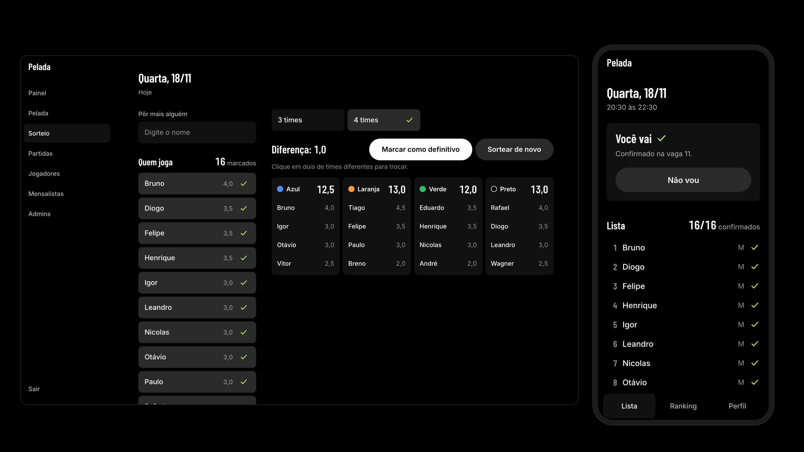
</p>

> [!NOTE]
> Every name and number in these screenshots is made up. They come from a demo database, not from the real group.

## Why

Our game is every Wednesday, 20:30 to 22:30, with 16 spots and a WhatsApp group of almost 40 people. For years it ran on a text list that everyone copied, edited and pasted back into the group. Two people would edit at the same time and someone would vanish from the list. Nobody knew who still had to confirm. The teams were drawn by hand on a phone, and the goals of the night were forgotten by Thursday.

Pelada replaces all of that with a site that opens in the browser, with nothing to install. Each player taps **I'm in** or **I'm out**. The organizers draw balanced teams in one tap and keep score during the game. A bot posts the list in the WhatsApp group by itself, says what changed, and answers when someone tags it.

The interface is in Portuguese and set to Recife's time zone, because that's where the game is. It was built for one group, but nothing in it is tied to that group.

## How it works

<table>
  <tr><td><b>Monday 00:00</b></td><td>The list for Wednesday opens. Monthly players (<i>mensalistas</i>, marked <b>M</b>) are already on it.</td></tr>
  <tr><td><b>Monday to Wednesday</b></td><td>Monthly players confirm their spot. Anyone else (<i>diaristas</i>, marked <b>D</b>) joins the list if there's a free spot, or the queue if it's full.</td></tr>
  <tr><td><b>Wednesday 14:00</b></td><td>Deadline for monthly players. Whoever didn't confirm loses the spot, and the queue moves up.</td></tr>
  <tr><td><b>Wednesday night</b></td><td>The organizer draws 3 or 4 teams balanced by rating, then records each match: goals, assists and the result.</td></tr>
  <tr><td><b>Always</b></td><td>The ranking adds it all up: points, wins, goals and assists, by month, by year or overall.</td></tr>
</table>

## Features

### For players: the list, on the phone

Log in with your name and a 4-digit PIN. The first screen is the week's list: whether you're in, your spot, who's confirmed (✓), who's still pending (⌛) and who's in the queue. **I'm in** and **I'm out** follow the rules above by themselves. **Copy list for WhatsApp** copies the list in the group's usual text format.

<p align="center">
  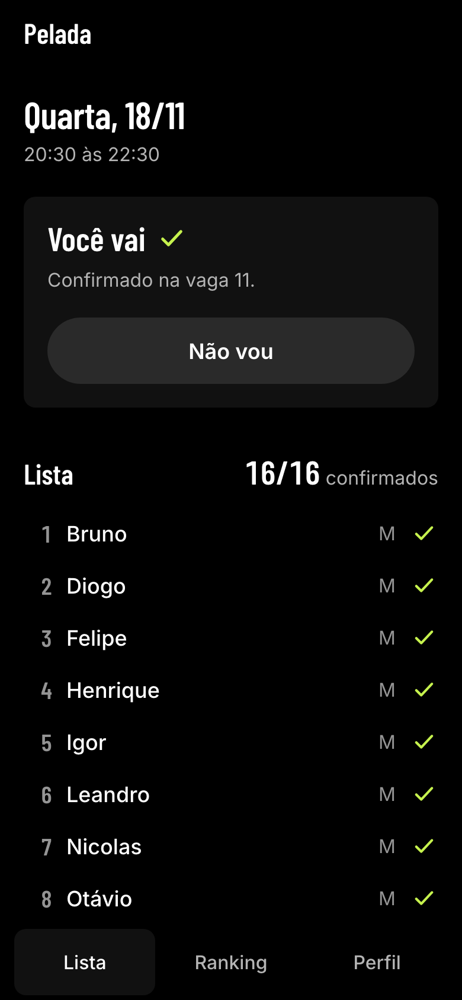
  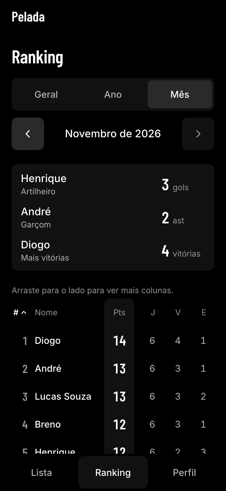
  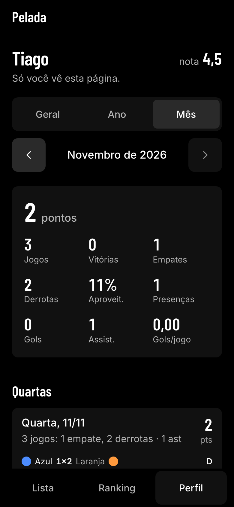
</p>

The **Ranking** shows the top scorer, top assister and most wins, plus a full table you can sort by any column. **Profile** has your own numbers and lets you change your PIN.

### For organizers: the week at a glance

On a computer, the admin area uses the whole screen, with a sidebar menu. The **Dashboard** sums up the week: how many confirmed, the queue, whether the teams are set, the matches of the night, monthly players and who still has the default PIN.

<p align="center">
  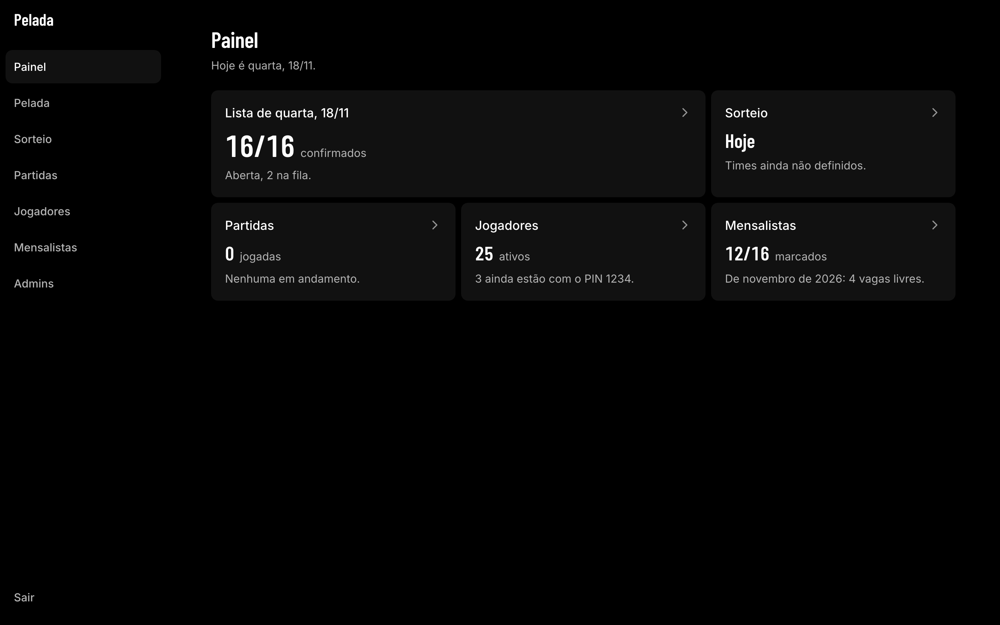
</p>

**Pelada** manages the list by hand: add someone, move people in and out, see the queue and who missed the deadline, and close or cancel the list.

<p align="center">
  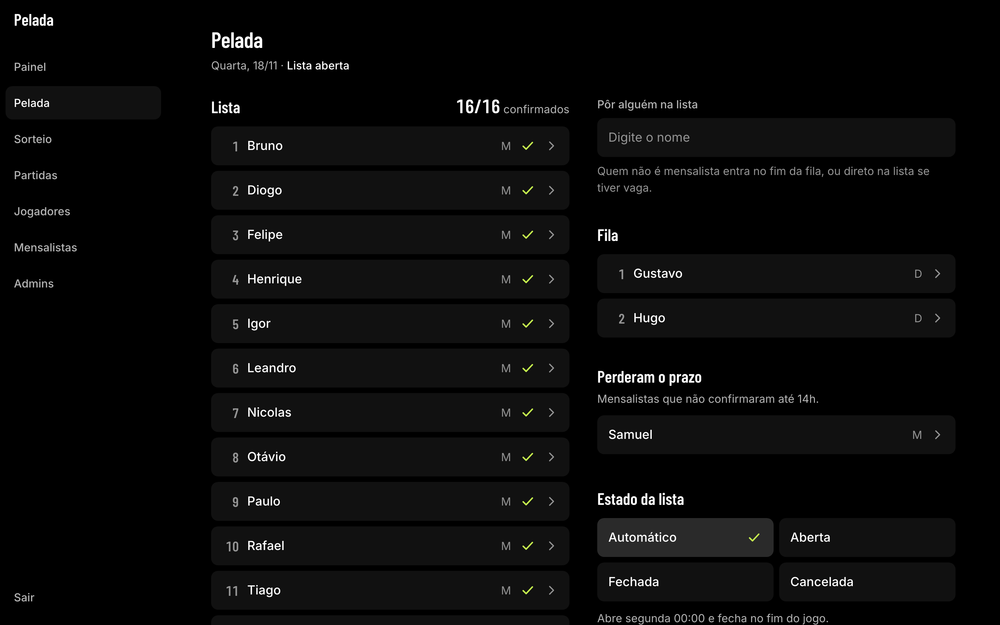
</p>

### Balanced teams in one tap

**Draw** starts with everyone on the list ticked. Choose **3 teams** or **4 teams** and tap **Draw**: the teams come out balanced by each player's rating, with the totals and the difference between the strongest and the weakest. Don't like it? Click two players from different teams to swap them, or draw again. If someone is missing, the spot becomes a **COMPLETE** that someone from another team fills during the match.

<p align="center">
  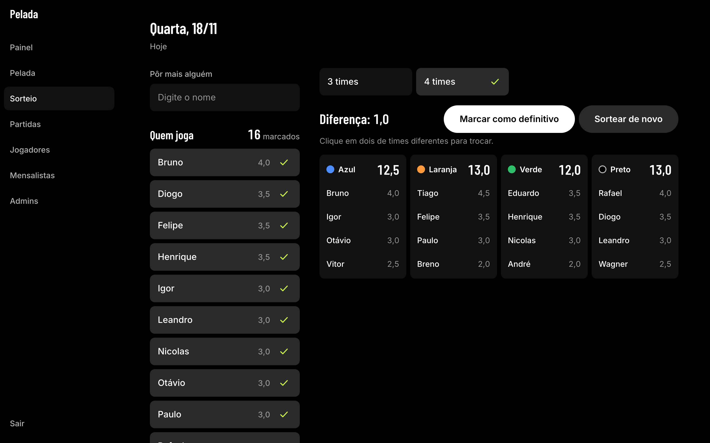
</p>

### Drew the teams somewhere else? Paste them

**Import teams** reads the teams straight from a WhatsApp message. Lines like “Team 1”, a blank line between teams, numbering, ratings, emoji, bold text and copied message headers (iPhone or Android) are all handled. Each name is matched to a registered player. When a name doesn't match, the screen suggests the closest one (“Did you mean Otávio?”) and only saves once every name is resolved.

<p align="center">
  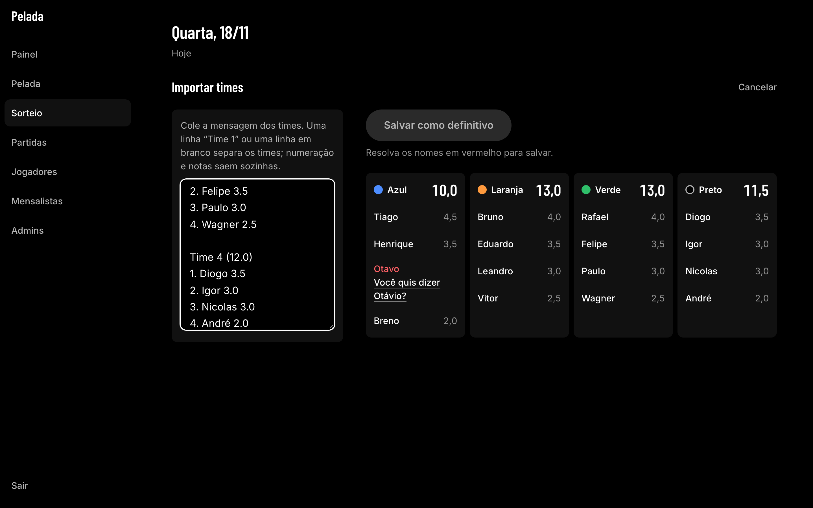
</p>

### Live scoring, from the side of the pitch

**Matches** suggests the next game from the team rotation. The scorer is a full-screen page made for a phone held at the edge of the pitch: a countdown, the score, and big **GOAL** and **AST** buttons for each player. **Undo** fixes a wrong tap, a notice appears on the third goal, and a finished match can still be corrected afterwards.

<p align="center">
  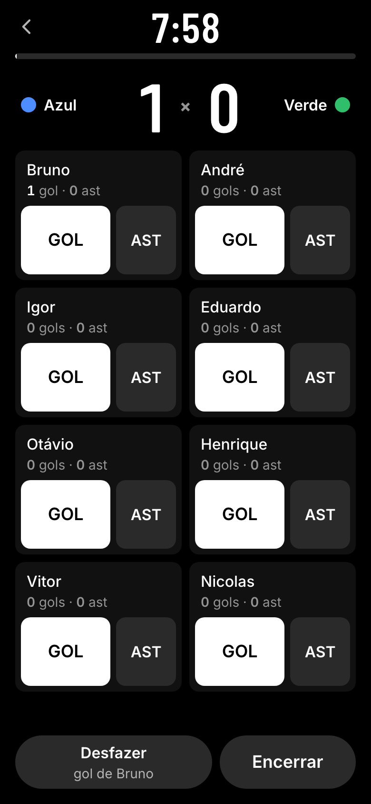
  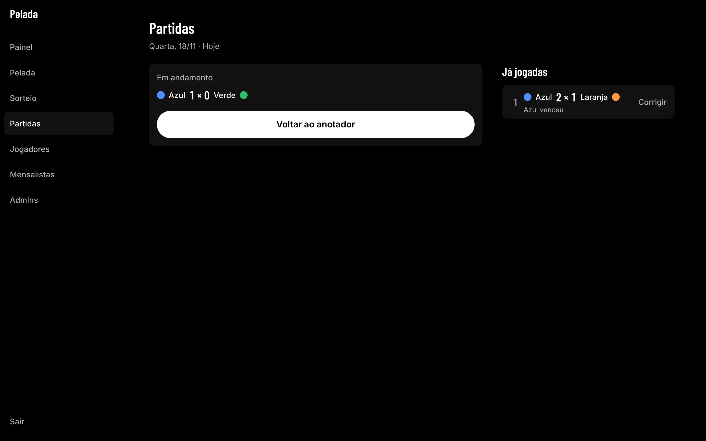
</p>

Organizers also manage **Players** (rating, reset PIN, deactivate), **Monthly players** for each month, and other **Admins**.

## The WhatsApp bot

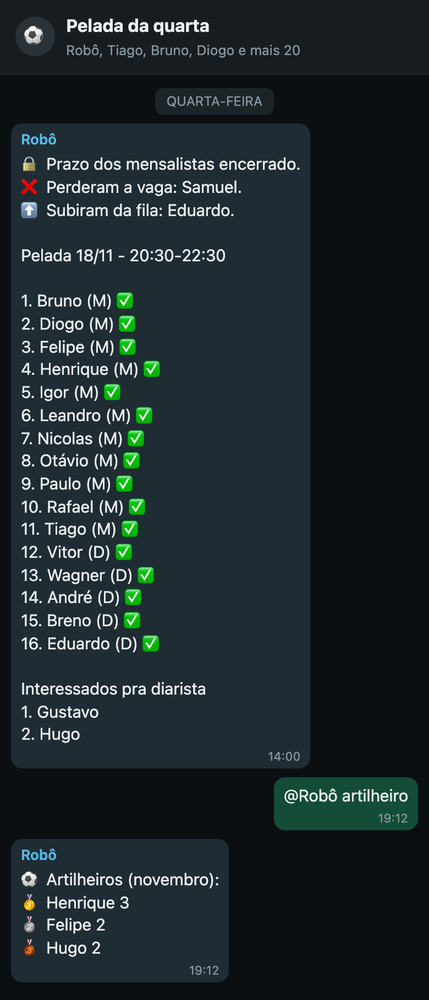

A spare WhatsApp number joins the group as a bot. It reads the list from the same database as the site, so the group sees exactly what the site shows, with nobody copying anything.

**It talks on its own**, Brazil time:
- **Monday 14:00:** the list is open.
- **Every half hour**, only if something changed: what happened (who confirmed, left, joined or moved up), then the list.
- **Wednesday 12:00:** a reminder with the monthly players who haven't confirmed.
- **Wednesday 14:00:** the deadline, who lost the spot and who moved up.
- Silence from 23:00 to 08:00. Whatever changes overnight goes out at 08:00.

**It answers when tagged.** `@bot list`, `missing`, `queue`, `top scorer`, `assists`, `ranking`, `teams`. Anyone in the group can `add`, `confirm` or `remove` up to three registered players by name, and every change shows who asked for it. Organizers (by phone number) can `draw` 3 or 4 teams; the bot shows the proposal and saves it when the same person replies `yes`. They can also `register` new players with their rating in one message, like `cadastrar Caio - 2,5 João - 3` (dot or comma both work). In a private chat with the bot, organizers also get `notas` (every rating), `nota Name 3,5` (change a rating) and `site` (the link); private messages from anyone else are ignored. On game night an organizer sends `@bot anotar` (in the group or privately) and gets a temporary link that opens only the match screens, no password needed, valid until 3 a.m.; a new link cancels the old one.

**It understands plain language (optional).** With an Anthropic API key, messages that aren't a command go to Claude Haiku, which answers questions about the list and the ranking and turns requests like “put Bruno and Diogo on the list” into the same actions as the commands. The bot checks who is asking from WhatsApp itself, not from the model, and it has daily and per-message limits.

The commands themselves are in Portuguese (`lista`, `falta confirmar`, `adicionar`…); tag the bot with `ajuda` to get the full list.

<br clear="right">

## Run it yourself

**Requirements:** Node.js 22 and pnpm. You don't need Docker or Postgres to try it: with a `DATABASE_URL` starting with `pglite:`, the database is a local folder.

```sh
git clone https://github.com/MarcoFilho1/pelada.git
cd pelada
pnpm install
export DATABASE_URL=pglite:./.pglite-dev
export SESSION_SECRET=a-local-secret-with-at-least-32-characters
export ADMIN_USUARIO=admin ADMIN_SENHA=a-password-of-10-or-more
pnpm db:migrate   # creates the tables
pnpm db:seed      # creates the first admin (does nothing if one exists)
pnpm dev          # http://localhost:3000
```

Players log in at `/entrar` (the first PIN is 1234 and must be changed). The organizer logs in at `/admin/entrar`. To wipe the local database, delete the `.pglite-dev` folder.

| Variable | What it's for |
|---|---|
| `DATABASE_URL` | In production, the pooled Neon URL (host ending in `-pooler`). Locally, `pglite:./.pglite-dev`. |
| `SESSION_SECRET` | Signs the session cookies. At least 32 characters. |
| `ADMIN_USUARIO`, `ADMIN_SENHA` | The first admin, created by `pnpm db:seed` if there is none yet. Password of at least 10 characters. |

### Put it online

The site runs on **Vercel** with a **Neon** Postgres database, both on their free plans. Create the Neon database, set the three variables in Vercel, and run the migrations once against Neon's direct (unpooled) URL. Step by step, in Portuguese: [docs/operacao.md](docs/operacao.md#publicar-vercel--neon).

### The bot

The bot runs on a Mac as a background service, connected to WhatsApp as a linked device (like WhatsApp Web), through [Baileys](https://github.com/WhiskeySockets/Baileys). You need a spare number that is already in the group.

```sh
pnpm robo:configurar --nome="Your group"   # scan the QR code with the bot's phone, pick the group
pnpm robo:ensaio                           # dry run: prints what it would send, sends nothing
pnpm robo:instalar                         # starts with the Mac and keeps running
```

Its settings (the database URL, the organizers' numbers and, optionally, the Anthropic key) live in a `.env` in `~/Library/Application Support/PeladaRobo/`, outside the project. The full guide, including updating and troubleshooting, is in [docs/operacao.md](docs/operacao.md#robô-do-whatsapp).

> [!WARNING]
> The bot uses an unofficial WhatsApp connection. With a few messages a week in a group that knows the number the risk is low, but WhatsApp can block the number. Use a spare one.

## FAQ

**Do players need to install anything?** No. It's a website that works on any phone or computer.

**How is the balance computed?** Each player has a rating from 0 to 5, in steps of 0.5, set by the organizers. The draw tries many random splits and keeps one where the team totals are close, so drawing again gives different teams that are still even. It shows the difference, and organizers can still swap players by hand before marking the teams as final.

**What if fewer than 16 show up?** The draw works with any number. Missing spots become COMPLETE slots, filled during each match by someone from a team that isn't playing.

**Can anyone change the list from WhatsApp?** Anyone in the group can add, confirm or remove registered players, as they already could on the text list. Every change made through the bot says who asked for it. Only organizers can draw the teams, and only admins can register new players, on the site.

**What does the AI cost?** It's optional. With Claude Haiku and the bot's limits (it only answers when tagged, at most 30 free-form questions a day), a group like ours costs cents a month. Without a key, the commands keep working.

**Is it for any group?** Yes. The game time, the 16 spots and the 14:00 deadline are in `src/domain/tempo.ts`. The interface is in Portuguese.

## How it was built

- **Site:** Next.js 16 (App Router), React 19, TypeScript and Tailwind CSS 4. Mobile first; from 1024 px the admin and player screens switch to a desktop layout.
- **Data:** Postgres with Drizzle ORM. Neon in production; PGlite (Postgres in WebAssembly) for development and tests, so no database server is needed.
- **Bot:** Node.js with Baileys for WhatsApp and the Anthropic SDK for Claude Haiku. It reuses the site's own code to read the list, so the text is identical to **Copy list**.
- **Tests:** about 800 unit and integration tests with Vitest (against an in-memory PGlite) and end-to-end tests with Playwright on a phone-sized browser.

```sh
pnpm lint && pnpm typecheck
pnpm test        # Vitest
pnpm test:e2e    # Playwright (first time: pnpm exec playwright install chromium)
```

Each feature started from a written design and a plan, which are kept in [docs/superpowers](docs/superpowers). The visual system ("a neighborhood scoreboard") is described in [DESIGN.md](DESIGN.md), and the product's tone in [PRODUCT.md](PRODUCT.md).
