<h1 align="center">
  <br>
  Pelada
</h1>

<p align="center">
  <a href="README.md">English</a> · <b>Português</b>
</p>

<p align="center">
  Tudo o que a pelada da semana precisa, num lugar só.<br>
  A lista de quem vai, times equilibrados, placar ao vivo, ranking e um robô no WhatsApp que mantém o grupo informado.
</p>

<p align="center">
  <a href="#como-funciona"><b>Como funciona</b></a> ·
  <a href="#funcionalidades"><b>Funcionalidades</b></a> ·
  <a href="#o-robô-do-whatsapp"><b>Robô do WhatsApp</b></a> ·
  <a href="#rodar-o-seu"><b>Rodar o seu</b></a> ·
  <a href="#perguntas-frequentes"><b>Perguntas</b></a> ·
  <a href="#como-foi-feito"><b>Como foi feito</b></a>
</p>

<p align="center">
  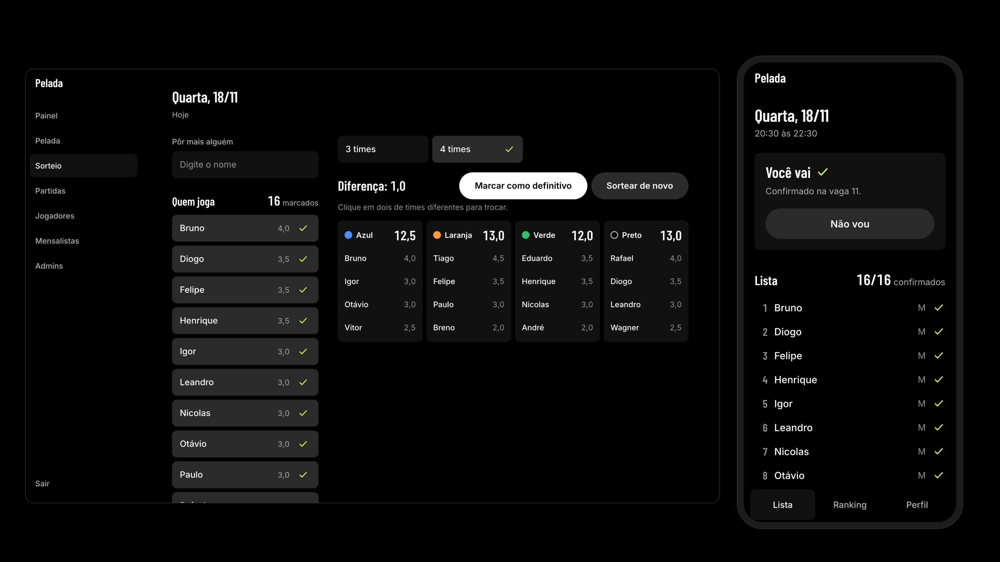
</p>

> [!NOTE]
> Todos os nomes e números dos prints são inventados. Eles vêm de um banco de demonstração, não do grupo de verdade.

## Por quê

A nossa pelada é toda quarta, das 20:30 às 22:30, com 16 vagas e um grupo de WhatsApp de quase 40 pessoas. Por anos ela funcionou com uma lista de texto que cada um copiava, editava e colava de volta no grupo. Duas pessoas editavam ao mesmo tempo e alguém sumia da lista. Ninguém sabia quem ainda faltava confirmar. Os times eram sorteados à mão no celular, e os gols da noite já estavam esquecidos na quinta.

O Pelada troca tudo isso por um site que abre no navegador, sem instalar nada. Cada jogador toca em **Vou** ou **Não vou**. Os organizadores sorteiam times equilibrados com um toque e anotam o placar durante o jogo. Um robô manda a lista no grupo do WhatsApp sozinho, diz o que mudou e responde quando alguém marca ele.

Ele foi feito para um grupo, mas nada nele depende desse grupo.

## Como funciona

<table>
  <tr><td><b>Segunda 00:00</b></td><td>Abre a lista de quarta. Os mensalistas (marca <b>M</b>) já entram nela.</td></tr>
  <tr><td><b>Segunda a quarta</b></td><td>Os mensalistas confirmam a vaga. Quem não é mensalista (diarista, marca <b>D</b>) entra na lista se tiver vaga, ou na fila se estiver cheia.</td></tr>
  <tr><td><b>Quarta 14:00</b></td><td>Prazo dos mensalistas. Quem não confirmou perde a vaga e a fila sobe.</td></tr>
  <tr><td><b>Quarta à noite</b></td><td>O organizador sorteia 3 ou 4 times equilibrados pela nota e anota cada partida: gols, assistências e resultado.</td></tr>
  <tr><td><b>Sempre</b></td><td>O ranking soma tudo: pontos, vitórias, gols e assistências, por mês, por ano ou no geral.</td></tr>
</table>

## Funcionalidades

### Para o jogador: a lista no celular

Entre com o seu nome e um PIN de 4 números. A primeira tela é a lista da semana: se você vai, a sua vaga, quem confirmou (✓), quem ainda não confirmou (⌛) e quem está na fila. **Vou** e **Não vou** seguem sozinhos as regras acima. **Copiar lista pro WhatsApp** copia a lista no formato de texto de sempre do grupo.

<p align="center">
  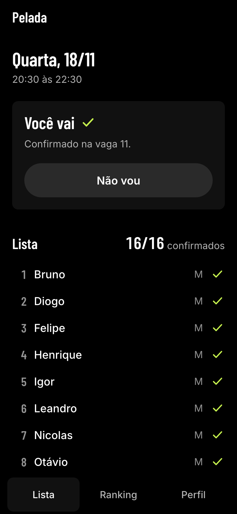
  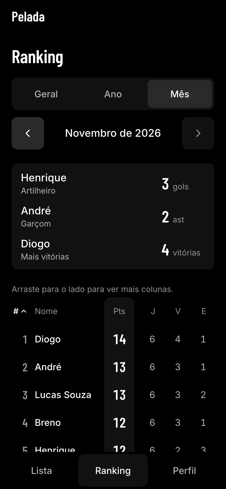
  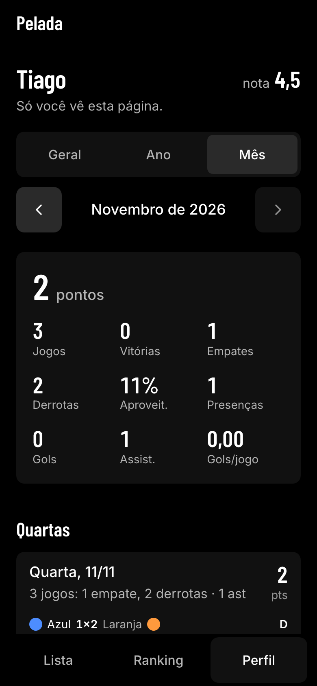
</p>

O **Ranking** mostra artilheiro, garçom e quem mais venceu, além da tabela completa, que dá para ordenar por qualquer coluna. No **Perfil** ficam os seus números e a troca de PIN.

### Para o organizador: a semana de relance

No computador, a área do admin usa a tela inteira, com um menu lateral. O **Painel** resume a semana: quantos confirmaram, a fila, se os times estão definidos, as partidas da noite, os mensalistas e quem ainda está com o PIN padrão.

<p align="center">
  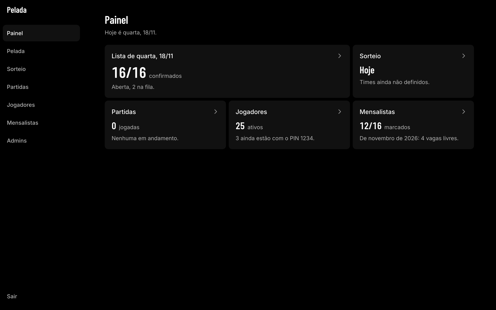
</p>

Em **Pelada** o admin mexe na lista à mão: põe alguém, tira, vê a fila e quem perdeu o prazo, e fecha ou cancela a lista.

<p align="center">
  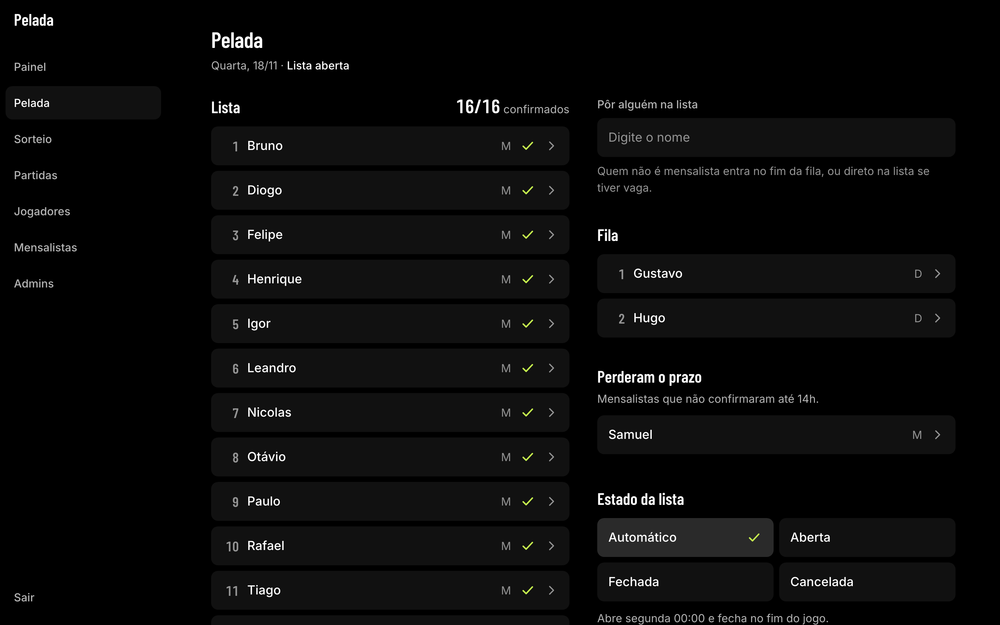
</p>

### Times equilibrados com um toque

O **Sorteio** começa com todo mundo da lista marcado. Escolha **3 times** ou **4 times** e toque em **Sortear**: os times saem equilibrados pela nota de cada jogador, com a soma de cada um e a diferença entre o mais forte e o mais fraco. Não gostou? Clique em dois jogadores de times diferentes para trocar os dois, ou sorteie de novo. Se faltar gente, a vaga vira um **COMPLETE**, que alguém de outro time preenche durante a partida.

<p align="center">
  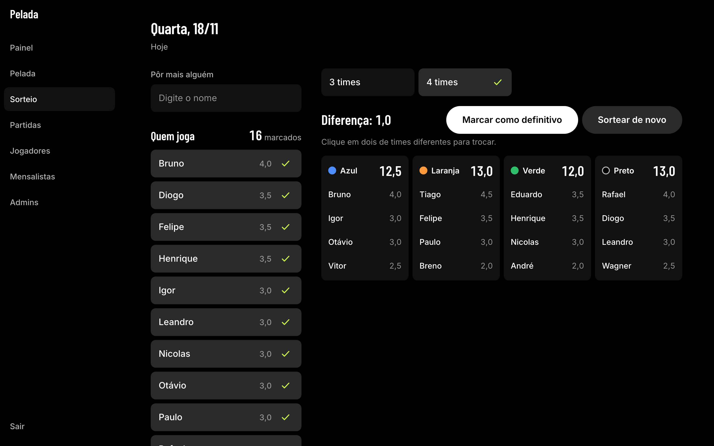
</p>

### Sorteou em outro lugar? Cole os times

**Importar times** lê os times direto de uma mensagem do WhatsApp. Ele entende linhas "Time 1", linha em branco entre os times, numeração, notas, emoji, negrito e o cabeçalho de mensagem copiada (do iPhone ou do Android). Cada nome é casado com um jogador cadastrado. Quando um nome não bate, a tela sugere o mais parecido ("Você quis dizer Otávio?") e só salva quando todos os nomes estão resolvidos.

<p align="center">
  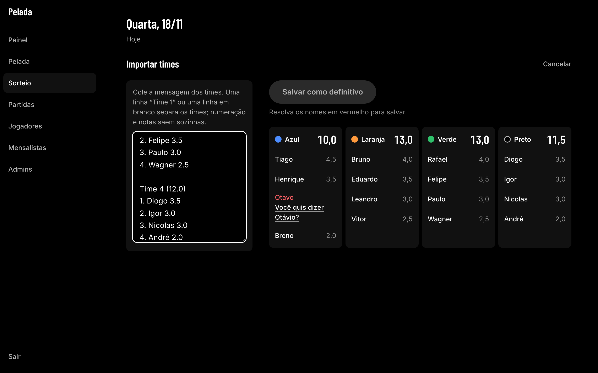
</p>

### Placar ao vivo, da beira da quadra

Em **Partidas**, o site sugere o próximo jogo pela fila de times. O anotador ocupa a tela inteira e foi feito para o celular na beira da quadra: cronômetro, placar e botões grandes de **GOL** e **AST** para cada jogador. **Desfazer** corrige um toque errado, um aviso aparece no terceiro gol, e dá para corrigir uma partida depois de encerrada.

<p align="center">
  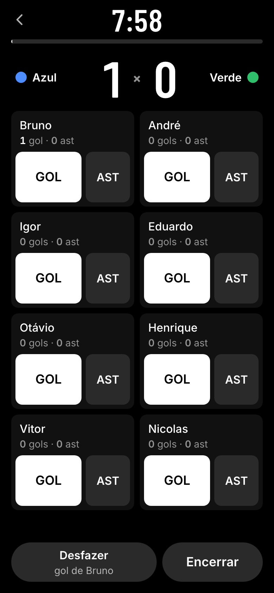
  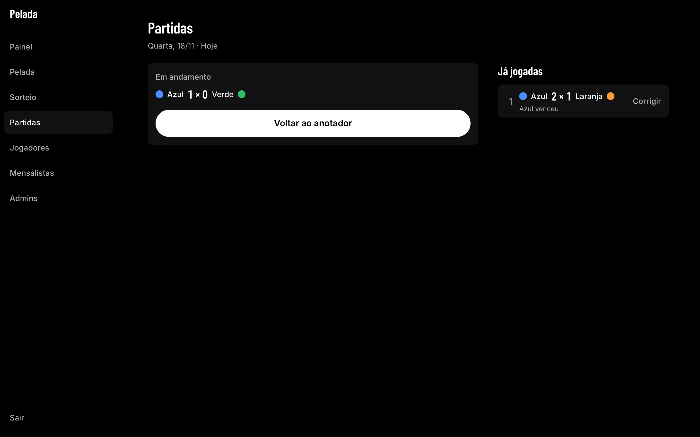
</p>

O admin também cuida dos **Jogadores** (nota, zerar PIN, desativar), dos **Mensalistas** de cada mês e dos outros **Admins**.

## O robô do WhatsApp

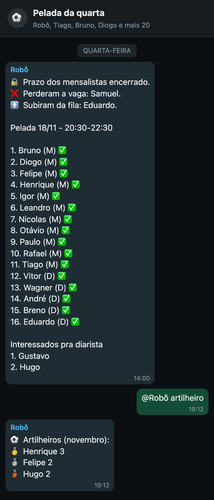

Um número de WhatsApp sobrando entra no grupo como robô. Ele lê a lista do mesmo banco do site, então o grupo vê exatamente o que o site mostra, sem ninguém copiar nada.

**Fala sozinho**, no horário de Recife:
- **Segunda 14:00:** a lista abriu.
- **A cada meia hora**, só se mudou algo: o que aconteceu (quem confirmou, saiu, entrou ou subiu da fila) e a lista.
- **Quarta 12:00:** lembrete com os mensalistas que ainda não confirmaram.
- **Quarta 14:00:** o prazo, quem perdeu a vaga e quem subiu.
- Silêncio das 23:00 às 08:00. O que mudar de madrugada sai junto às 08:00.

**Responde quando é marcado.** `@robô lista`, `falta confirmar`, `fila`, `artilheiro`, `garçom`, `ranking`, `times`. Qualquer pessoa do grupo pode `adicionar`, `confirmar` ou `remover` até três jogadores cadastrados pelo nome, e toda mudança mostra quem pediu. Os organizadores (pelo número) podem `sortear` 3 ou 4 times, no grupo ou no privado, ou colar times feitos fora com `importar` (no privado). Os times só valem quando 2 dos 3 organizadores respondem `sim` (quem propôs também confirma); aí o robô salva no site, e quem propôs manda os times no grupo, com as notas, respondendo `mandar` no privado. Enquanto a proposta espera, `times` no grupo responde que ainda não foram definidos, então nada vaza. Também podem `cadastrar` jogadores novos com a nota, vários numa mensagem só, como `cadastrar Caio - 2,5 João - 3` (vale ponto ou vírgula). No privado do robô, os organizadores também têm `notas` (todas as notas), `nota Fulano 3,5` (muda a nota) e `site` (o link); privado de qualquer outra pessoa é ignorado. Na noite do jogo, um organizador manda `@robô anotar` (no grupo ou no privado) e recebe um link temporário que abre só as telas de partida, sem senha, válido até as 3h; um link novo cancela o anterior.

**Entende português do dia a dia (opcional).** Com uma chave da API da Anthropic, o que não é comando vai para o Claude Haiku, que responde perguntas sobre a lista e o ranking e transforma pedidos como "bota o Bruno e o Diogo na lista" nas mesmas ações dos comandos. Quem está pedindo o robô confere pelo próprio WhatsApp, nunca pelo modelo, e há limites por dia e por mensagem.

Marque o robô com `ajuda` para ver todos os comandos.

**Roda no Mac ou num celular Android.** O robô pode ficar num app Android, em segundo plano, no celular de quem organiza: o app leva dentro a conexão com o WhatsApp e o robô, se atualiza sozinho com versões assinadas e avisa quando o aparelho some. O app fica em [pelada-android](https://github.com/MarcoFilho1/pelada-android); o lado do robô e do site está em [docs/android.md](docs/android.md).

<br clear="right">

## Rodar o seu

**Precisa de:** Node.js 22 e pnpm. Para testar, não precisa de Docker nem de Postgres: com uma `DATABASE_URL` começando com `pglite:`, o banco é uma pasta local.

```sh
git clone https://github.com/MarcoFilho1/pelada.git
cd pelada
pnpm install
export DATABASE_URL=pglite:./.pglite-dev
export SESSION_SECRET=um-segredo-local-com-mais-de-32-caracteres
export ADMIN_USUARIO=admin ADMIN_SENHA=uma-senha-de-10-ou-mais
pnpm db:migrate   # cria as tabelas
pnpm db:seed      # cria o primeiro admin (não faz nada se já existe um)
pnpm dev          # http://localhost:3000
```

Os jogadores entram em `/entrar` (o primeiro PIN é 1234 e precisa ser trocado). O organizador entra em `/admin/entrar`. Para apagar o banco local, remova a pasta `.pglite-dev`.

| Variável | Para quê |
|---|---|
| `DATABASE_URL` | Em produção, a URL do Neon com pool (host terminado em `-pooler`). No seu computador, `pglite:./.pglite-dev`. |
| `SESSION_SECRET` | Assina os cookies de sessão. Mínimo de 32 caracteres. |
| `ADMIN_USUARIO`, `ADMIN_SENHA` | O primeiro admin, criado por `pnpm db:seed` se ainda não existir nenhum. Senha com pelo menos 10 caracteres. |

### Pôr no ar

O site roda na **Vercel** com um banco Postgres no **Neon**, os dois no plano grátis. Crie o banco no Neon, configure as três variáveis na Vercel e rode as migrações uma vez com a URL direta (sem pool) do Neon. O passo a passo está em [docs/operacao.md](docs/operacao.md#publicar-vercel--neon).

### O robô

O robô roda num Mac como um serviço em segundo plano, conectado ao WhatsApp como aparelho conectado (como o WhatsApp Web), pela biblioteca [Baileys](https://github.com/WhiskeySockets/Baileys). Você precisa de um número sobrando que já esteja no grupo.

```sh
pnpm robo:configurar --nome="Seu grupo"   # leia o QR com o celular do robô e escolha o grupo
pnpm robo:ensaio                          # ensaio: mostra o que mandaria, sem mandar nada
pnpm robo:instalar                        # liga junto com o Mac e fica rodando
```

As configurações (a URL do banco, os números dos organizadores e, se quiser, a chave da Anthropic) ficam num `.env` em `~/Library/Application Support/PeladaRobo/`, fora do projeto. O guia completo, com atualização e o que fazer quando algo dá errado, está em [docs/operacao.md](docs/operacao.md#robô-do-whatsapp).

> [!WARNING]
> O robô usa uma conexão não oficial com o WhatsApp. Com poucas mensagens por semana num grupo que conhece o número o risco é baixo, mas o WhatsApp pode bloquear o número. Use um número sobrando.

## Perguntas frequentes

**O jogador precisa instalar alguma coisa?** Não. É um site que funciona em qualquer celular ou computador.

**Como o equilíbrio é calculado?** Cada jogador tem uma nota de 0 a 5, de 0,5 em 0,5, definida pelos organizadores. O sorteio testa muitas divisões aleatórias e fica com uma em que as somas dos times ficam próximas, então sortear de novo dá times diferentes e ainda parelhos. Ele mostra a diferença, e o organizador ainda pode trocar jogadores à mão antes de marcar os times como definitivos.

**E se vierem menos de 16?** O sorteio funciona com qualquer número. As vagas que faltam viram COMPLETE, preenchidas em cada partida por alguém de um time que está de fora.

**Qualquer um pode mexer na lista pelo WhatsApp?** Qualquer pessoa do grupo pode adicionar, confirmar ou remover jogadores cadastrados, como já fazia na lista de texto. Toda mudança feita pelo robô diz quem pediu. Só os organizadores sorteiam, e só os admins cadastram jogadores novos, no site.

**Quanto custa a IA?** Ela é opcional. Com o Claude Haiku e os limites do robô (só responde quando é marcado, no máximo 30 perguntas livres por dia), um grupo como o nosso gasta centavos por mês. Sem chave, os comandos continuam funcionando.

**Serve para outro grupo?** Serve. O horário do jogo, as 16 vagas e o prazo das 14:00 estão em `src/domain/tempo.ts`.

## Como foi feito

- **Site:** Next.js 16 (App Router), React 19, TypeScript e Tailwind CSS 4. Pensado primeiro para o celular; a partir de 1024 px, as telas do admin e do jogador mudam para o layout de computador.
- **Dados:** Postgres com Drizzle ORM. Neon em produção; PGlite (Postgres em WebAssembly) no desenvolvimento e nos testes, sem precisar de servidor de banco.
- **Robô:** Node.js com Baileys para o WhatsApp e o SDK da Anthropic para o Claude Haiku. Ele usa o próprio código do site para ler a lista, então o texto é idêntico ao do **Copiar lista**.
- **Testes:** cerca de 800 testes de unidade e integração com Vitest (contra um PGlite em memória) e testes de ponta a ponta com Playwright num navegador do tamanho de um celular.

```sh
pnpm lint && pnpm typecheck
pnpm test        # Vitest
pnpm test:e2e    # Playwright (na primeira vez: pnpm exec playwright install chromium)
```

Cada funcionalidade começou com um desenho escrito e um plano, guardados em [docs/superpowers](docs/superpowers). O sistema visual ("placar de várzea") está em [DESIGN.md](DESIGN.md), e o tom do produto em [PRODUCT.md](PRODUCT.md).
