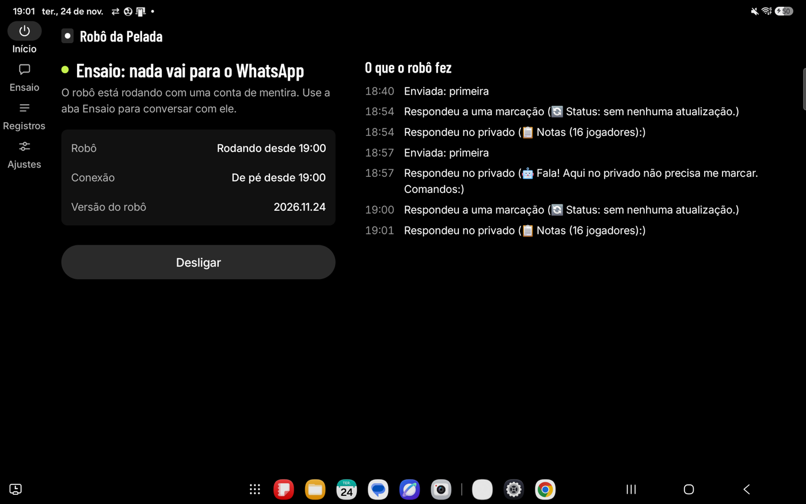
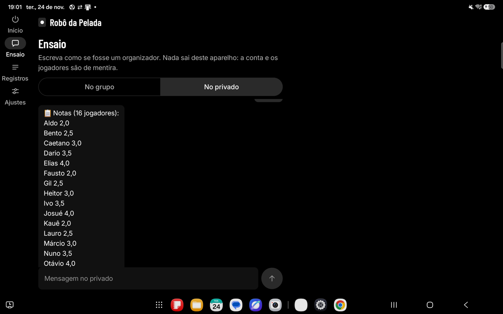

# Robô no Android

O robô e o ZapGate podem rodar dentro de um app Android, no celular de alguém, em segundo
plano, enquanto a pessoa usa o aparelho normalmente. O banco (Neon) e a IA (Anthropic) continuam
na nuvem; o que vai para o celular é a conexão com o WhatsApp e a lógica do robô.

O app fica na pasta `android/`. Ele **não** tem a lógica do robô: só liga, vigia e atualiza dois
programas que vão dentro dele.

| Parte | O que é | De onde vem |
| --- | --- | --- |
| ZapGate | mantém a conexão com o WhatsApp e aplica as regras anti-ban | compilado do repositório do ZapGate (Rust) para Android |
| Node | roda o código do robô | pacote `nodejs-lts` do projeto Termux (Node 24, completo) |
| Robô | o mesmo código de `src/robo`, num arquivo só | `scripts/compilar-robo-android.mjs` |

## Como funciona por dentro

- **Serviço em primeiro plano** (`ServicoRobo`): é o que mantém tudo vivo com a tela apagada e o
  app fechado. O Android exige que ele mostre uma notificação fixa ("Robô da Pelada"). Ele segura
  o processador e o Wi-Fi acordados e religa sozinho quando o aparelho reinicia.
- **Dois processos filhos** (`Filho`): o ZapGate e o Node rodam como programas separados do app.
  Se um cair, o app espera um pouco e liga de novo (1 s, 2 s, 5 s, 15 s, 30 s, 60 s; volta ao
  começo depois de um minuto de pé). O robô só liga depois que o ZapGate responde.
- **Restos de uma execução anterior** (`Orfaos`): se o Android matar o app sem aviso, os dois
  programas podem ficar soltos segurando a sessão. Antes de ligar, o app os encerra.
- **Tudo na área privada do app**: `zapgate/` (regras, chaves, sessão), `robo/` (configuração e
  estado), `codigo/` (o robô, uma pasta por versão), `logs/`.

## Configuração: o pacote

O app não tem campos para digitar chave nem regra. Ele recebe um **pacote** (.zip) montado no
computador de quem cuida do robô, com:

```
app.json               o pouco que o app precisa saber (nome da conta, se é ensaio…)
zapgate/zapgate.toml   as regras do ZapGate
zapgate/.env           as chaves do ZapGate
zapgate/dados/         (opcional) a sessão do WhatsApp trazida de outro aparelho
robo/.env              a configuração do robô (nos valores, ${APP} vira a pasta do app)
robo/estado.json       (opcional) o estado do robô
```

O app confere o pacote antes de trocar qualquer coisa: item fora dessas pastas, ou pacote sem as
partes obrigatórias, é recusado e a configuração atual fica como estava.

## Ensaio (sem WhatsApp e sem o banco de verdade)

O pacote de ensaio usa o **motor simulado** do ZapGate (nada chega ao WhatsApp) e um **banco de
mentira** com jogadores de nomes inventados:

```sh
pnpm tsx android/scripts/montar-pacote-ensaio.mts            # só comandos
ANTHROPIC_API_KEY=... pnpm tsx android/scripts/montar-pacote-ensaio.mts --com-ia   # com a IA (gasta crédito)
```

Sai em `dist/android/pacote-ensaio.zip`.

## Montar e instalar

Precisa, uma vez: JDK 17, Android SDK (plataforma 37.2 e NDK 29), `rustup target add
aarch64-linux-android`, e o código do ZapGate numa pasta.

```sh
ZAPGATE_DIR=/caminho/do/zapgate android/scripts/preparar.sh   # Node + ZapGate + robô para dentro do app
cd android && ./gradlew :app:assembleDebug                    # gera app/build/outputs/apk/debug/app-debug.apk
adb install -r app/build/outputs/apk/debug/app-debug.apk
```

Pôr o pacote pelo cabo (só em versão de desenvolvimento) e abrir o app:

```sh
P=dev.marcofilho.pelada.robo
adb exec-in run-as $P sh -c 'cat > files/pacote.zip' < dist/android/pacote-ensaio.zip
adb shell am force-stop $P && adb shell am start -n $P/.MainActivity
```

Testes do app (sem aparelho): `cd android && ./gradlew :app:testDebugUnitTest`.

## O que foi medido (Galaxy Tab S9 FE, Android 16)

- ZapGate: ~8 MB de memória. Node com o robô: ~260 MB **no ensaio** (o banco de mentira roda
  inteiro dentro do Node); com o banco de verdade na nuvem é bem menos.
- Com a tela apagada e o aparelho forçado ao modo de economia mais fundo (Doze), os dois
  programas continuaram de pé e o robô seguiu dando a volta de 1 em 1 minuto.

## Decisões e limites

- **Por que não o nodejs-mobile**: é o Node 18 sem suporte a Unicode (ICU). `normalize('NFD')`
  não faz nada e `\p{L}` nem compila: o robô compararia nomes com acento errado, sem avisar.
- **Só ARM de 64 bits** (`arm64-v8a`): todo celular e tablet Android atual.
- **Fora da Play Store**: o app é instalado por APK. Ele executa programas que leva dentro e
  (na fase de atualização) baixa código novo do robô, o que a Play Store não permite.
- **Certificados HTTPS**: o Node roda com `--use-bundled-ca` (usa a lista de autoridades que vem
  nele), porque o Node do Termux procuraria a lista numa pasta que não existe no app.
- **Processos filhos no Android 12+**: o sistema pode encerrar processos filhos de apps quando
  há muitos no aparelho ou quando gastam muita CPU. Com dois processos leves não apareceu nos
  testes; se acontecer, o app religa (e fica registrado em `logs/`).
- **A auto-revisão (`claude -p`) não vai para o celular**: continua no Mac.
- **Nunca duas conexões no mesmo número**: o robô do Mac tem de estar desligado enquanto o do
  celular estiver ligado na mesma conta.

## As telas

O visual é o do site (`DESIGN.md`): chão preto, placas um degrau de luz acima, Barlow Condensed
nos títulos e números, Inter no resto, lima só para "está vivo". No celular a navegação fica
embaixo; no tablet, num trilho ao lado.

| Tela | Para que serve |
| --- | --- |
| **Início** | diz em uma frase como o robô está, mostra o que ele fez por último e tem o botão de ligar e desligar; avisa se a bateria ou a notificação estão bloqueadas |
| **Conectar o WhatsApp** | gera o código de 8 letras (em placas, como o PIN do site) para digitar no WhatsApp do mesmo aparelho; tem contagem do prazo e botão de copiar |
| **Ensaio** | só no pacote de ensaio: uma conversa de mentira com o robô, no grupo ou no privado |
| **Registros** | o que o robô e a conexão escreveram, com botão de compartilhar para mandar a quem cuida |
| **Ajustes** | trocar o pacote, abrir o painel de regras do ZapGate, bateria, notificação e versões |




Por que código e não QR para conectar: o WhatsApp está no mesmo aparelho, e não dá para apontar
a câmera para a própria tela.

## Atualização

Há dois tipos, e o comum não exige reinstalar nada.

**Robô novo (o caso do dia a dia).** O app consulta um arquivo pequeno, o *manifesto*, de 6 em 6
horas com o robô ligado (e no botão **Ajustes › Procurar atualização**). Se houver versão mais
nova, ele baixa o arquivo do robô, confere, troca e reinicia **só o robô**: o WhatsApp continua
conectado.

- **Assinatura.** Cada versão é assinada no computador de quem cuida do robô, com uma chave
  privada que nunca sai de lá. O app só tem a chave pública, que confere mas não assina. Um arquivo
  trocado no caminho, ou assinado por outra chave, é recusado. Por isso o lugar onde os arquivos
  ficam hospedados não precisa ser de confiança.
- **Volta sozinho.** Depois de trocar, o app observa o robô por 3 minutos. Se ele cair 3 vezes, ou
  não ficar 1 minuto de pé, a versão anterior volta e a versão ruim fica anotada para não ser
  tentada de novo.
- **Só para a frente.** Uma versão só entra se o número dela (a data do commit) for maior que o
  da atual.

**App novo (raro).** Quando o manifesto traz um APK mais novo, aparece o botão **Instalar o app**.
O arquivo já vem conferido pela mesma assinatura, e o Android ainda confere que o APK foi assinado
por quem assinou o app instalado. Na primeira vez o Android pede para permitir "instalar apps
desta fonte", e o Play Protect pode perguntar se quer enviar o app para análise (dá para escolher
"Instalar sem análise") e pedir o PIN do aparelho.

### Publicar uma versão

```sh
node scripts/android/publicar-robo.mjs chave    # uma vez: cria a chave e mostra a pública
node scripts/android/publicar-robo.mjs          # empacota, assina e gera dist/android/publicar/
```

A chave pública e o endereço do manifesto vão no `app.json` do pacote:

```json
{ "atualizacao_url": "https://…/manifesto.json", "atualizacao_chave": "<a pública>", "atualizacao_token": "<opcional>" }
```

O conteúdo de `dist/android/publicar/` é para subir, como está, para esse endereço (só HTTPS).
Se o servidor pedir senha, o `atualizacao_token` é mandado como `Authorization: Bearer`.

Para incluir um app novo: `./gradlew :app:assembleRelease -Pcodigo=2 -Pversao=0.2.0` e
`publicar-robo.mjs --app=caminho.apk --app-versao=0.2.0 --app-numero=2`.

## Sinal de vida (suporte à distância)

De minuto em minuto, com o robô ligado, o app conta ao site como está. Quando o sinal para de
chegar, quem cuida do robô fica sabendo que o aparelho sumiu (desligou, ficou sem internet, ou o
Android matou o app).

**O que vai no sinal:** estado da conta do WhatsApp, se o robô está rodando, quantas vezes cada
programa caiu, versões, bateria, e as últimas linhas que o próprio app escreveu (ligou, caiu,
atualizou). **Nunca** vai conversa, nome nem número de ninguém.

**No site** (`/api/robo/sinal`, tabela `robo_sinais`, migração `0008`):

- `POST`: o app manda o sinal.
- `GET`: responde `200` se está tudo certo e `503` com a frase do problema quando o celular sumiu
  (sem sinal há mais de 5 minutos), o WhatsApp desconectou ou o robô parou.
- As duas pedem a chave `ROBO_SINAL_CHAVE` (24+ caracteres) em `Authorization: Bearer`. Sem essa
  variável no site, a rota recusa todo mundo.

**No pacote** (`app.json`): `"sinal_url": "https://<site>/api/robo/sinal"`, `"sinal_chave": "<a chave>"`
e, se quiser, `"aparelho": "celular do Fulano"`.

**Para ser avisado**, no Mac:

```sh
ROBO_SINAL_URL=https://<site>/api/robo/sinal ROBO_SINAL_CHAVE=<a chave> node scripts/android/vigiar-sinal.mjs
ROBO_SINAL_URL=… ROBO_SINAL_CHAVE=… node scripts/android/vigiar-sinal.mjs --uma-vez   # só olha agora
```

O vigia pergunta de 2 em 2 minutos e mostra uma notificação do macOS quando aparece um problema e
quando volta ao normal. Ele só avisa com o Mac ligado: para ser avisado sempre, dá para apontar
um serviço de monitoramento (com aviso por e-mail ou Telegram) para o mesmo endereço.

Por que o aviso não chega pelo WhatsApp do robô: o número do robô está no celular que sumiu.

**Para pôr no ar:** rodar a migração `0008` no banco, criar `ROBO_SINAL_CHAVE` na Vercel e
publicar o site.

## Mudar o robô do Mac para o celular

O pacote de verdade é montado a partir do que o robô usa hoje no Mac:

```sh
node scripts/android/montar-pacote.mjs --com-sessao \
  --sinal-url=https://<site>/api/robo/sinal --sinal-chave=<a chave> --aparelho="celular do Fulano" \
  --atualizacao-url=https://…/manifesto.json --atualizacao-chave=<a pública>
```

Ele copia as regras do ZapGate e a configuração do robô como estão (conta, limites, grupos,
organizadores, Pix, horários) e muda só o necessário: caminhos, e as chaves entre o robô e o
ZapGate, que são criadas novas para o celular.

**Com `--com-sessao`** a sessão do WhatsApp vai junto: para o WhatsApp continua sendo o mesmo
aparelho conectado, então não precisa parear de novo (menos risco para o número). **Sem** ela, o
celular pareia pelo código de 8 letras na tela Conectar.

A ordem, no dia:

1. No Mac, desligar o robô e o ZapGate, e não ligar mais nessa conta:
   `launchctl bootout gui/$(id -u)/com.pelada.robo` e `launchctl bootout gui/$(id -u)/zapgate`.
2. Montar o pacote (comando acima) e mandar o `dist/android/pacote.zip` direto para o aparelho.
3. No app: **Importar pacote**, permitir bateria e notificação, **Ligar**.
4. Conferir no Início que aparece "WhatsApp conectado" e, no Mac, `vigiar-sinal.mjs --uma-vez`.
5. Apagar o pacote do computador e do aparelho (ele leva a chave do banco e a da IA).

Nunca os dois ligados na mesma conta: foi o que derrubou a sessão em 10/11.

**Para voltar ao Mac:** desligar o robô no app e **parear de novo no Mac** (`zapgate pair pelada`).
Se a sessão foi para o celular, a cópia que ficou no Mac está desatualizada (as chaves da conversa
avançam a cada mensagem) e não deve ser religada.
